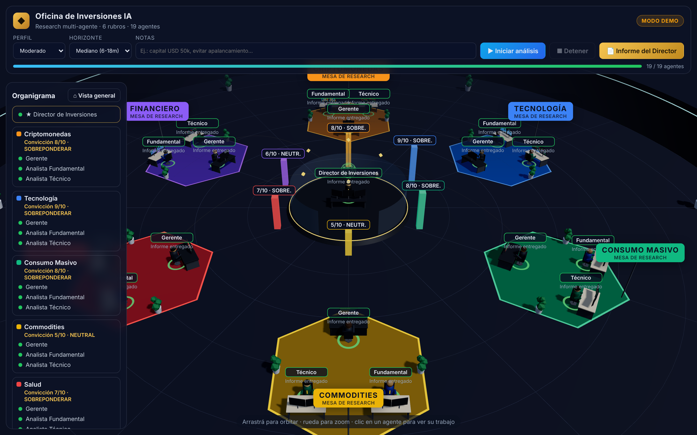

# 🏢 Oficina de Inversiones IA

Es una oficina virtual en 3D donde **19 agentes de IA (Claude)** buscan oportunidades de compra en 6 rubros, como lo haría un equipo de research con experiencia.



## Organización

```
                     ┌──────────────────────────────┐
                     │ Director de Inversiones (CIO)│  → Informe centralizado
                     └──────────────▲───────────────┘
        ┌──────────┬──────────┬─────┴────┬──────────┬──────────┐
     Gerente    Gerente    Gerente    Gerente    Gerente    Gerente     → Informe unificado por rubro
     Cripto     Tecno.     Consumo    Commod.    Salud      Financ.
      ▲  ▲       ▲  ▲       ▲  ▲       ▲  ▲       ▲  ▲       ▲  ▲
     F    T     F    T     F    T     F    T     F    T     F    T     → Analista Fundamental / Técnico
```

| Nivel | Agentes | Qué hace |
|---|---|---|
| **Analistas** (12) | 1 fundamental + 1 técnico por rubro | Buscan datos actuales en la web y proponen de 3 a 5 oportunidades de compra. El fundamental arma tesis, métricas, catalizadores, precio objetivo y riesgos. El técnico indica tendencia, señales, entrada, stop, objetivos y relación riesgo/beneficio. Cada rubro tiene su propio marco de análisis (por ejemplo, on-chain y tokenomics en cripto, NIM y CET1 en financiero, pipeline y FDA en salud). |
| **Gerentes** (6) | 1 por rubro | Cruzan los dos informes y arman una matriz de convergencia. Marcan divergencias y controlan la calidad de los datos. Emiten una recomendación sectorial (sobreponderar, neutral o subponderar), una convicción de 1 a 10 y el top 3 del rubro. |
| **Director** (1) | CIO | Integra los 6 informes. Escribe el resumen ejecutivo y el contexto macro, arma el mapa sectorial, el **top 10 de oportunidades de toda la firma**, la cartera modelo, el plan de ejecución, la gestión de riesgos, el calendario de catalizadores y las ideas descartadas. |

Cada gerente arranca apenas terminan sus dos analistas. El director arranca cuando terminaron los 6 gerentes.

## La oficina 3D

- Cada rubro tiene su propia mesa (hexágono de color) con sus dos analistas y su gerente. El director está en la plataforma central.
- **Anillo de estado** debajo de cada agente: gris = inactivo, violeta = en cola, ámbar = trabajando, verde = entregado, rojo = error. Mientras trabajan, las pantallas se animan y el rótulo muestra la búsqueda en curso.
- Cuando un nivel entrega su informe al siguiente, se ven **paquetes de información** viajando entre los puestos.
- Las **barras de convicción** alrededor del director crecen según la nota de cada gerente.
- Si hacés clic en un agente (o en el organigrama), se abre un panel con su actividad (búsquedas web) y su informe completo, que podés descargar en `.md`.
- El **Informe del Director** se abre al terminar y se puede descargar en `.md` o imprimir como PDF.

## Uso

```bash
npm install
cp .env.example .env     # poné tu ANTHROPIC_API_KEY
npm start                # http://localhost:3000
```

Elegí el perfil de riesgo, el horizonte y, si querés, notas (capital, restricciones). Después presioná **▶ Iniciar análisis**.

- **Sin `ANTHROPIC_API_KEY`**, la oficina funciona en **MODO DEMO**, con informes simulados (marcados como tales), para que puedas recorrer el flujo completo sin costo.
- **Con clave**, cada agente usa Claude con **búsqueda web** para obtener precios, resultados y noticias actuales, y cita sus fuentes.

Cada corrida se guarda en `reports/`: el informe del director (`.md`) y todos los informes en un `.json`.

## Configuración (`.env`)

| Variable | Default | Descripción |
|---|---|---|
| `MODEL_ANALYST` / `MODEL_MANAGER` / `MODEL_DIRECTOR` | `claude-opus-5-5` | Modelo para cada nivel |
| `EFFORT_ANALYST` / `EFFORT_MANAGER` / `EFFORT_DIRECTOR` | `high` / `high` / `xhigh` | Profundidad de razonamiento (`low`…`max`) |
| `MAX_SEARCHES_PER_ANALYST` | `8` | Búsquedas web por analista |
| `CONCURRENCY` | `4` | Agentes trabajando en simultáneo (ajustalo a tu rate limit) |

> **Costo:** una corrida completa hace 19 llamadas al modelo y hasta unas 120 búsquedas web. Si querés abaratarla, bajá el esfuerzo o usá `claude-sonnet-5-5` para los analistas.

## Arquitectura

- `server/agents.js`: rubros, universos de cobertura y prompts de cada rol.
- `server/llm.js`: llamada a la API de Claude con streaming, pensamiento adaptativo, búsqueda web, reanudación de `pause_turn` y *fallback* del lado del servidor si el modelo rechaza la solicitud.
- `server/orchestrator.js`: flujo jerárquico analistas → gerentes → director, con límite de concurrencia.
- `server/demo.js`: generador de informes simulados.
- `server/index.js`: Express con API REST y eventos en tiempo real (SSE).
- `public/`: oficina 3D en Three.js, con labels CSS2D, organigrama y render de Markdown.

## Aviso legal

Los informes los generan agentes de IA con fines informativos y educativos. **No constituyen asesoramiento financiero personalizado.** Verificá siempre los datos antes de invertir.
